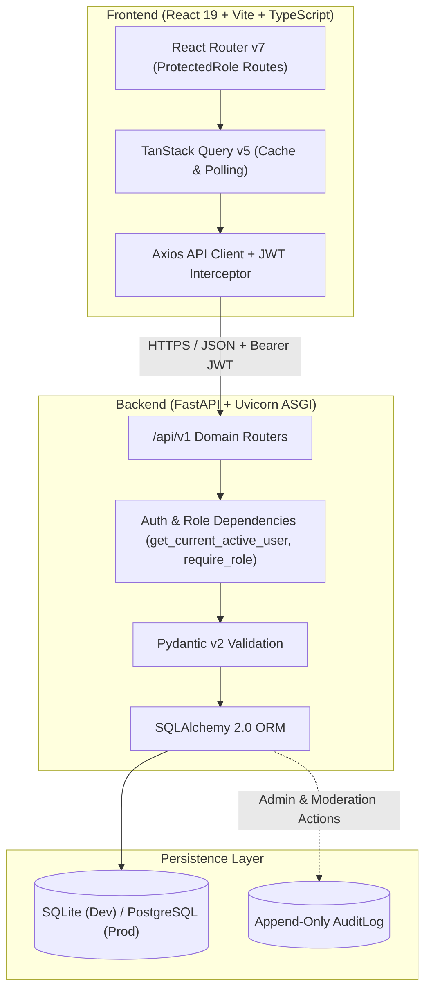
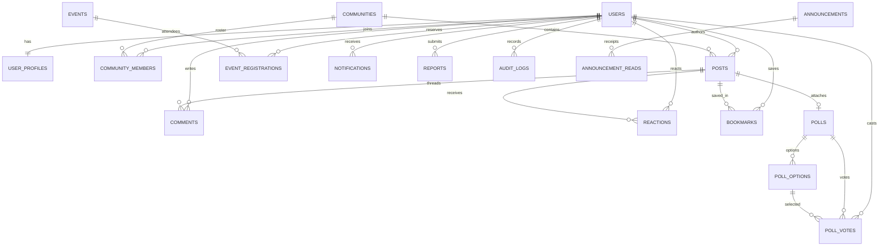

# Benchpost Architecture & Engineering Guide

Benchpost is a full-stack university student community and collaboration platform built with a **React + TypeScript** single-page frontend and a **FastAPI + SQLAlchemy 2.0** REST backend.

---

## 1. High-Level Architecture

---

## 2. Database Entity Relationships (14 Tables)

---

## 3. Role-Based Access Control (RBAC)

Authorization is enforced server-side on every protected FastAPI route using dependency injection (`backend/app/api/deps.py`):

| Role | Capabilities |
| :--- | :--- |
| **`STUDENT`** | Register/login, update profile, browse/join/leave communities, create posts in joined communities, threaded comments, reactions, bookmarks, vote in polls, RSVP/cancel event seats, mark announcements/notifications read, report inappropriate content. |
| **`FACULTY`** | All student capabilities, plus creating communities, managing private community approval queues, organizing campus events, publishing official announcements, and reviewing moderation reports. |
| **`ADMIN`** | Full platform access, plus `/api/v1/admin/*` telemetry analytics, user directory search, role promotion/demotion (`PUT /users/{id}/role`), moderation resolution, and immutable audit log inspection. |

---

## 4. Concurrency & Data Integrity Guarantees

1. **Event Overbooking Prevention (`events` & `event_registrations`):**
   - Event seat reservations execute inside an atomic database transaction using row-level locking (`SELECT ... FOR UPDATE` via SQLAlchemy `with_for_update()`), preventing concurrent requests from exceeding `max_capacity`.
   - `UniqueConstraint('event_id', 'user_id')` prevents duplicate registrations per user.
2. **Duplicate Vote & Reaction Prevention (`poll_votes`, `reactions`):**
   - Single-choice polls enforce uniqueness per `(poll_id, user_id)` and validate `expires_at` on the server before recording votes.
   - Post reactions enforce one active reaction per `(post_id, user_id)` and toggle/switch cleanly.
3. **Non-Repudiation (`audit_logs`):**
   - Role changes (`UPDATE_USER_ROLE`) and moderation resolutions (`MODERATION_REMOVE_CONTENT`, `MODERATION_DISMISS`, `MODERATION_USER_WARNED`) write an immutable `AuditLog` record inside the same database transaction.
4. **Dual-Dialect Storage:**
   - Defaults to local SQLite (`sqlite:///./campusloop.db`) with `check_same_thread=False`, and switches seamlessly to PostgreSQL (`DATABASE_URL`) by omitting SQLite-only `connect_args`.

---

## 5. Deployment Notes

- **Frontend (GitHub Pages):** Automated via [`.github/workflows/deploy-pages.yml`](../.github/workflows/deploy-pages.yml). Sets `VITE_BASE_PATH` dynamically from `actions/configure-pages` and copies `dist/index.html` to `dist/404.html` so React Router `BrowserRouter` paths resolve on page reload.
- **Backend (Optional Cloud Host):** Deploy `backend/` to Render, Railway, Fly.io, or a VPS with a persistent PostgreSQL database (`DATABASE_URL`), strong `SECRET_KEY`, and `BACKEND_CORS_ORIGINS` including your frontend origin (`https://vasishtaaa.github.io`), then set `VITE_API_URL` as a GitHub Actions Repository Variable.
